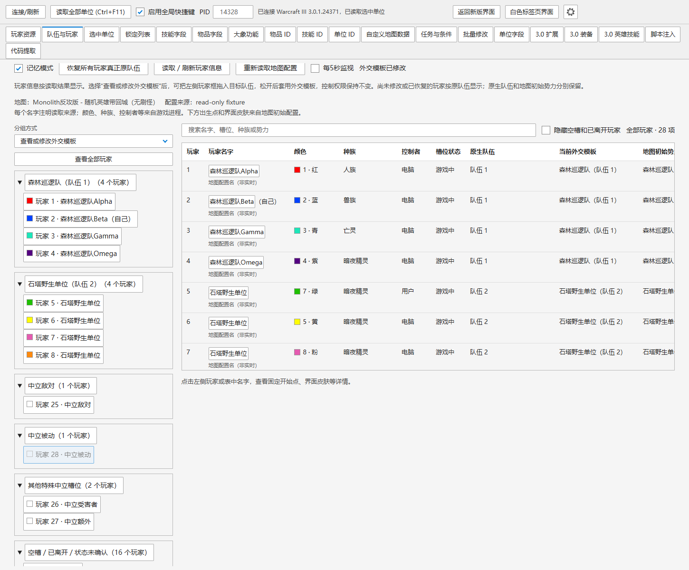

# 魔兽争霸 III 重制版修改器 FullClone

## 当前 3.0+ 扩展测试版：v2.2.3 FullClone R31.14-Test

基于[原作者项目](https://github.com/dc114154qq/war3-reforged-trainer)的 **v2.2.3 / e4930f5e0739** 源码，保留作者3.0读取、字段、扩展背包、装备、英雄技能、脚本和存档工具，加入FullClone累计扩展。本项目为非官方扩展测试版。

- **[R31.14 发布与下载](https://github.com/37f/war3-reforged-trainer-fullclone/releases/tag/v2.2.3-fullclone-r31.14-test)**
- **[Windows 单文件 EXE](https://github.com/37f/war3-reforged-trainer-fullclone/releases/download/v2.2.3-fullclone-r31.14-test/War3ReforgedTrainer-v2.2.3-FullClone-R31.14-Test.exe)**
- [完整源码 ZIP](https://github.com/37f/war3-reforged-trainer-fullclone/releases/download/v2.2.3-fullclone-r31.14-test/War3ReforgedTrainer-v2.2.3-FullClone-R31.14-Test-source.zip)
- [完整中文使用说明](source-v2.2.3/R31_14_使用说明.md) · [本版更新](source-v2.2.3/R31_14_更新说明.md) · [校验和验证记录](releases/v2.2.3-R31.14/)

### R31.14 修复：中立外交模板往返

修复中立被动拖到普通队伍再拖回后仍有敌意、中立敌对拖回后仍友好的问题。旧逻辑复制中立玩家已经改变的当前关系；本版从本次地图首次修改前的记录回溯相关双向关系，避免中立自身的快照受到其他玩家更早修改的影响。队伍页拖放、大象加入队伍按钮和Ctrl+F1共用修复，普通玩家套用中立模板时也适用。控制权限保持当前状态，原恢复记录保留。

中立玩家的队伍原始值0显示为“特殊中立槽位（原生队伍原始值0）”，不再误标普通队伍1。相对R31.13，本次没有改动原进程/单位读取、native协议、生产DLL或版本配置。

### R31.7 之后累计加入的功能

- **查看或修改外交模板**：原队伍名称、队伍编号和人数；包含自己玩家；可拖动玩家框到其他队伍。未修改或已恢复的玩家按原队伍显示，原生编号和地图初始势力分别保留。
- **控制权限修复**：加入队伍不再复制其他玩家的共享控制标志；控制/恢复玩家仍是单独功能。
- **恢复所有玩家真正原队伍**：大象功能和队伍页都有按钮；按首次记录逆序恢复，避免连续换队覆盖较早的原始关系。
- **记忆模式**：队伍与玩家、任务与条件切页返回保留结果、选择、筛选、勾选和滚动；隐藏页面停止定时读取，换图/重连后校验旧结果。任务分析仍需手动点击检测。
- **每5秒监视单位状态**：选中单位页默认关闭，开启后跟随游戏当前选择更新生命、魔法、坐标和字段；慢请求不重叠，编辑时跳过本轮，读取失败后关闭。选中玩家名字与队伍监视的勾选也支持切页记忆。

### 累计扩展一览

| 类别 | 功能 |
| --- | --- |
| 复制与归属 | 面板复制归属开关；关闭时作者归属逻辑，开启时按自己、选中单位所属玩家或指定玩家执行；覆盖复制、大量复制、呼叫增援。Ctrl+A始终给自己。复用作者3.0完整状态复制事务。 |
| 玩家、控制与队伍 | Ctrl+I+U交给指定玩家；Ctrl+I+O控制/恢复选中玩家；Ctrl+F1套用队伍1～12或中立外交模板；单个/全部恢复首次记录的关系；玩家名字/队伍监视；队伍成员与全部玩家信息；外交模板拖放。 |
| 单位与英雄 | Ctrl+U+8替换单位（默认zhyd）；Ctrl+空格补满生命魔法；碰撞开关；单位/玩家颜色；Ctrl+F+H复活选中玩家阵亡英雄；每5秒选中单位监视。 |
| 等级、属性与金矿 | Ctrl+Q默认每次升1级，可选自定义；Alt+Q默认永久三围各加2，可选自定义；Alt+空格设置选中金矿黄金。 |
| 地狱火与物品 | Ctrl+F2在鼠标位置施放AUin地狱火；Alt+F2将符合条件的地面原物品实例聚集到鼠标位置。 |
| 自定义ID | 从当前地图/战役章节或指定文件读取单位、技能、物品和科技目录。 |
| 任务与条件 | 手动检测主线、支线及可解析完成/失败条件；保留原说明；每秒同步能唯一绑定的任务状态；勾选触发位置后展示条件/触发前地点及独立本地视角跳转。Lua只显示能确认的静态信息，未知项明确标注。 |
| 界面 | 现代深色、白色标签页、1.0.19旧式三列六组；同窗口共用连接、参数和恢复记录；任务长文本可用滚轮查看。 |

### 升级、验证与范围

1. 保存进度，在旧修改器先恢复需要恢复的队伍关系，再关闭旧修改器。原始关系快照不跨EXE进程传递；新程序不能推断此前未交给它的旧记录。
2. 从R31.11或更早（包括GitHub此前的R31.7）升级，请完整退出并重开游戏以载入R31.12起的helper。R31.12新增独立指定玩家操作19/20，不改变游戏选择。R31.14的DLL与R31.13相同，仅为本次修复不要求重启游戏。
3. 打开本版EXE连接游戏；同一时间使用一份修改器。外交模板改变双向关系，保留原生队伍编号；不把中立槽位硬改成普通队伍。

**验证：**253项测试通过，包括真实x64桥接测试夹具；旧逻辑5个回归场景先复现失败，修复后通过。Edge三种布局中立拖放6个往返使用模拟RPC验证。冻结EXE18页面/77快捷键、221个包内模块与源码一致；源码ZIP669个文件已逐个回读校验。未向当前运行的游戏执行本次外交写入，不将离线测试等同实际地图验收。名字读不到时使用带来源标识的地图初始配置名；Lua实时任务状态仍为未确认。

原作者适配配置见[profiles](source-v2.2.3/profiles/)。自动任务来源仅在已核对精确构建3.0.1.24371开放；不承诺所有版本、地图逐项验收。Alt+B保留作者秘籍；已经移除的玩家直接胜利、强制完成任务、名称修改和旧建造加速实验不恢复。

当前3.0源码位于 **[source-v2.2.3/](source-v2.2.3/)**，与本次完整源码ZIP逐字节一致；上传现成本地EXE/ZIP，没有为发布重编译。构建报告中的“未发布”是当时状态，公开发布状态以本次发布页为准。

[R31.7 历史发布](https://github.com/37f/war3-reforged-trainer-fullclone/releases/tag/v2.2.3-fullclone-r31.7-test) · [R31.5 历史发布](https://github.com/37f/war3-reforged-trainer-fullclone/releases/tag/v2.2.3-fullclone-r31.5-test)。旧版发布、标签、附件及2.0.4源码继续保留；已撤销的R24.1不重新发布。

---

## 以下为旧版 1.0.19 / 游戏2.0.4 历史说明

以下版本号、快捷键和验证结论仅描述对应历史版本；当前3.0版请使用上面的R31.14说明。

这是基于[原作者的 v1.0.19 源码提交](https://github.com/dc114154qq/war3-reforged-trainer/tree/4124cd582ed624eeb85d665484755fa8cae65697)制作的非官方扩展版。本仓库不代表原作者发布；原项目的功能与本扩展的改动请分别参看源码和[迁移审计](releases/v1.0.19-R16/FULLCLONE_MIGRATION_AUDIT.md)。

本分支当前为 **v1.0.19 FullClone R29-Test 任务位置显示开关版**。默认保留原任务说明、目标、完成／失败条件及状态同步；只有勾选“触发位置”才显示区域、坐标、触发前入口和点击定位链接。原任务说明始终保留在详情前面，取消勾选即隐藏位置并停用新的跳转点击。官方安装基础脚本、自定义战役章节和独立地图共用任务检索入口；目标游戏保持 2.0.4.23745 x64。

当前新功能测试版为 **R29-Test**，现有正式版仍为 R19.2。R29 沿用本地已交付的 EXE，没有为上传重新编译；源码标签对应 `ea44436`。使用方法见 [R29说明](source/R29_任务位置显示开关使用说明.md)，证据与限制见 [R29验证记录](source/R29_VERIFICATION.md)。R23“完成任务”执行设计已撤销，R29 继续只读检索任务，不恢复执行功能。

R29 同时包含 R25 的每秒任务完成／失败状态同步、R26 的独立本地相机定位、R27 的区域／单位／物品／建筑／镜头等地点关联、R28 的创建／发现任务入口线索。现有接口没有读取接取／发现状态；动态位置、复杂间接入口和无法确认的来源明确提示。191 项检查及冻结包校验通过；新增位置未逐项进行游戏内验收，具体边界见验证记录。R29 显示调整没有改动读取、单位参数、native 或相机入口。

2026-10-27 曾按用户要求撤销 R24.1，删除独立发布、标签及本地成品，当时源码恢复为 R24。相关改动和验证只作为 [R24 版本记录](source/R24_VERSION_HISTORY.md) 保留；R24 原程序和源码包不变。本次不重新发布已撤销的 R24.1。

## R19.2 之后的版本

| 版本 | 主要变化 | 发布与下载 |
| --- | --- | --- |
| R19.3-Test | 原队伍为 -1 的玩家应用及恢复外交模板。 | [R19.3](https://github.com/37f/war3-reforged-trainer-fullclone/releases/tag/v1.0.19-fullclone-r19.3-test) |
| R20-Test | 从战役文件和所选章节只读检索自定义单位、技能及物品 ID。 | [R20](https://github.com/37f/war3-reforged-trainer-fullclone/releases/tag/v1.0.19-fullclone-r20-test) |
| R21-Test | 在修改器中直接检索当前地图的自定义 ID，换图后清理旧目录。 | [R21](https://github.com/37f/war3-reforged-trainer-fullclone/releases/tag/v1.0.19-fullclone-r21-test) |
| R22-Test | 检索当前地图任务、JASS 完成及失败条件和脚本证据。 | [R22](https://github.com/37f/war3-reforged-trainer-fullclone/releases/tag/v1.0.19-fullclone-r22-test) |
| R23-Test（历史存档） | 官方基础脚本来源适配及任务原流程执行实验；执行功能后来已撤销，不推荐使用本版。 | [R23 历史版](https://github.com/37f/war3-reforged-trainer-fullclone/releases/tag/v1.0.19-fullclone-r23-test) |
| R24-Test | 删除任务执行；只读展示主线、支线、目标和易读完成／失败条件。 | [R24](https://github.com/37f/war3-reforged-trainer-fullclone/releases/tag/v1.0.19-fullclone-r24-test) |
| **R29-Test** | 保留 R25～R28 的任务状态同步、多类型条件与触发前定位；默认显示原任务说明，勾选“触发位置”后显示坐标并可定位本地视角。 | **[R29](https://github.com/37f/war3-reforged-trainer-fullclone/releases/tag/v1.0.19-fullclone-r29-test)** |

每版附件包含独立 EXE、对应源码、中文说明、原验证记录和 SHA-256 校验文件；发布标签对应各版原源码提交。R21 源码 ZIP 仅清理夹带的 30 个旧发布文件，保留的源码逐文件核对原提交、字节不变，本地旧包保留。历史文档中“尚未上传”描述生成时状态，公开发布以各版本页面及附件 `PUBLICATION_INTEGRITY.json` 为准。

以下保留 **v1.0.19 FullClone R19.2** 的历史发布说明和下载链接。该版保留此前全部扩展及 R18 的四项修复；R19 在原队伍监视中加入所属玩家的实际名字，R19.1 精简中立名字提示，R19.2 修复自定义战役中原生队伍为 `-1` 时监视报错误13的问题。当时已连续三次成功读回，用户确认正式 EXE“显示正常，无原错误”；这不代表其他功能或所有地图均已实测。

## 下载

- [R29-Test 新功能测试版](https://github.com/37f/war3-reforged-trainer-fullclone/releases/tag/v1.0.19-fullclone-r29-test)
- [R29 Windows EXE](https://github.com/37f/war3-reforged-trainer-fullclone/releases/download/v1.0.19-fullclone-r29-test/War3ReforgedTrainer-v1.0.19-FullClone-R29-Test.exe)
- [R29 完整源码 ZIP](https://github.com/37f/war3-reforged-trainer-fullclone/releases/download/v1.0.19-fullclone-r29-test/war3-reforged-trainer-v1.0.19-fullclone-r29-test-source.zip)
- [R29 中文任务使用说明](source/R29_任务位置显示开关使用说明.md)
- [R24 历史测试版](https://github.com/37f/war3-reforged-trainer-fullclone/releases/tag/v1.0.19-fullclone-r24-test)

以下为 R19.2 正式版及其历史文档：

- [R19.2 发布与下载页面](https://github.com/37f/war3-reforged-trainer-fullclone/releases/tag/v1.0.19-fullclone-r19.2)
- [Windows 单文件 EXE](https://github.com/37f/war3-reforged-trainer-fullclone/releases/download/v1.0.19-fullclone-r19.2/War3ReforgedTrainer-v1.0.19-FullClone-R19.2.exe)
- [R19.2 完整源码 ZIP](https://github.com/37f/war3-reforged-trainer-fullclone/releases/download/v1.0.19-fullclone-r19.2/war3-reforged-trainer-v1.0.19-fullclone-r19.2-source.zip)，也可直接浏览 [source/](source/)
- [完整中文使用说明](releases/v1.0.19-R19.2/V19_FULL_USAGE_GUIDE_ZH.md)
- [R19.2 战役队伍监视修复说明](releases/v1.0.19-R19.2/R19_2_UNASSIGNED_TEAM_NOTES.md)
- [验证记录](releases/v1.0.19-R19.2/R19_2_VERIFICATION.md)及[包校验报告](releases/v1.0.19-R19.2/r19.2-package-verification.json)
- [SHA-256 校验文件](releases/v1.0.19-R19.2/SHA256SUMS.txt)

旧版 [R19.1 发布](https://github.com/37f/war3-reforged-trainer-fullclone/releases/tag/v1.0.19-fullclone-r19.1)、[R18 发布](https://github.com/37f/war3-reforged-trainer-fullclone/releases/tag/v1.0.19-fullclone-r18)、[R16 发布](https://github.com/37f/war3-reforged-trainer-fullclone/releases/tag/v1.0.19-fullclone-r16)及其仓库目录保留，便于回退。R19.2 是新的独立程序，不覆盖旧 EXE。

## R17～R19.2 更新

| 版本 | 内容 |
| --- | --- |
| R17 | 在目标单位面板监视实时选中单位的所属玩家、队伍和中立槽位，切换队伍前可先确认；查询不改变归属、队伍或外交关系。 |
| R18：全光环 / 全被动 | 查询地图技能的实际等级上限，将这两项预设的请求等级限制在 `min(112, 上限)`；不改变普通手动技能等级设置。 |
| R18：获得 6 个神器 | 允许安全地确保 `AInv` 背包存在，保留已有背包；仍按作者原规则替换六槽物品。**先存档或使用空背包。** |
| R18：全屏群星陨落 | 只针对 `AEsb` 修复结束清理：不打断后来接受的新命令，不覆盖地图随后写入的新范围；保留真实失败及对象身份校验。 |
| R19：实际玩家名字 | 合并到原“读取队伍”和每秒监视，显示选中单位所属玩家的编号、实际名字和队伍；中文名字在英文界面保持原文。名字读取失败不沿用旧名字，读取期间改选或取消选择时拒绝迟到结果，不修改名字或队伍。 |
| R19.1：中立显示 | 玩家25（中立敌对）及玩家28（中立被动）名字不可用时省略“名称暂无法读取”；保留编号、中立标识和队伍信息，普通玩家提示不变。 |
| R19.2：战役未分配队伍 | 监视允许原生队伍 `-1`，显示“未分配普通队伍（原始值 -1）”，继续显示玩家编号和能读取的名字，不误报为未选择、队伍0或中立队伍。只兼容只读监视，不改变加入/恢复队伍或其他修改功能。 |

升级到 R19.2 前，请先保存进度、关闭旧修改器，完整退出并重启游戏，再只运行 R19.2。新版 helper 已重新编译，旧 helper 可能常驻，仅换 EXE 不会清除它；不要同时运行多个修改器版本。R19→R19.1 曾仅为显示调整，无需重开游戏的旧说明不适用于升级 R19.2。

## 历次 FullClone 扩展功能

以下列的是本扩展在作者 v1.0.19 功能之外增加或调整的项目；不是原作者版本的功能清单。操作位置、参数、完整快捷键及限制见[完整中文使用说明](releases/v1.0.19-R19.2/V19_FULL_USAGE_GUIDE_ZH.md)。

| 分类 | 扩展内容 |
| --- | --- |
| 复制与归属 | 在“大象功能 → 创建与物品”增加“启用面板复制归属”开关。默认关闭，面板复制、大量复制和 `Ctrl+B` 保留源单位归属，呼叫增援沿用作者的本地玩家逻辑；开启后，它们和 `Ctrl+K` 呼叫增援按面板选择给自己、选中单位所属玩家或指定玩家（玩家 1～24、中立敌对、中立被动）。`Ctrl+A` 始终复制给自己。 |
| 完整复制事务 | 复制单位及大量复制无需预先读取选中单位；复制英雄等级/经验、永久三围、可用技能点、技能及等级、生命/魔法、背包物品数量和作者开放的物品实例字段。 |
| 单位归属与玩家控制 | `Ctrl+I+U` 把选中单位交给指定玩家；`Ctrl+I+O` 控制或恢复选中单位所属玩家，不改变归属或阵营。不存在的普通玩家槽位会拒绝操作。 |
| 队伍与中立玩家 | `Ctrl+F1` 将选中单位所属玩家加入队伍 1～12，或套用中立敌对/中立被动外交模板；“恢复原队伍”使用首次切换前保存的队伍和双向联盟关系，不把中立玩家猜成普通队伍。R17 起增加选中玩家队伍监视，方便切换前核对。 |
| 单位操作 | `Ctrl+U+8` 按输入的四字符 ID 替换选中单位（默认 `zhyd`）；`Ctrl+空格` 将选中单位生命、可用魔法加满；`Alt+L` 切换碰撞，再按一次恢复。另可设置单位显示颜色或所属玩家颜色，不改变归属。 |
| 英雄与金矿 | `Ctrl+F+H` 把选中单位所属玩家的阵亡英雄复活到鼠标位置；`Ctrl+Q` 默认每次升 1 级、勾选后使用自定义等级；`Alt+Q` 默认永久三围各加 2、勾选后使用自定义值；`Alt+空格` 设置选中金矿的剩余黄金。非英雄、非金矿目标分别静默跳过。 |
| 地狱火与胜利 | `Ctrl+F2` 在鼠标位置施放 `AUin` 地狱火，使用临时施法载体触发技能的陨石、落地和眩晕效果；`Alt+B` 可选择作者原胜利秘籍或“玩家直接胜利”。 |

R16 另修复了大量复制和 `Ctrl+N` 调用批量方法时的 `preserve_owner` 参数错误，使每次复制按上述开关和归属选择执行。此前还修复了英雄升级的返回值判定；这些是兼容性修复，不是新增游戏功能。

**未包含的项目：**游戏速度功能因实机测试无效已移除；单位显示名称、英雄专有名称修改因有崩溃风险已移除；“选中玩家的建造/研究/造兵/建筑升级每秒推进约 20 秒”没有迁入本版。`Alt+V` 保留作者原有的 `warpten` 快速建造/研究逻辑。

运行前先启动游戏并进入地图，再以管理员身份运行修改器、连接游戏进程。切换地图或重启游戏后应重新连接。复制归属开关和快捷键的具体用法见使用说明。

## 验证范围

R19.2 源码完整回归结果为 `1890 passed, 12 skipped, 113 subtests passed`。冻结包验证确认应用版本 `1.0.19`、helper 协议 `76`、内置 DLL 身份、源码一致性和离线自检。跳过的 12 项不算通过。当前战役原先出错单位的监视已连续三次成功读回“玩家7、队伍-1”，用户确认正式 R19.2 界面“显示正常，无原错误”。该玩家名字目前没有可读取内容，按原有普通玩家规则提示，不再让其阻断归属/队伍显示。受控测试和当前单位验收不等于所有地图验收，其他功能的跨地图效果仍需另测。

R19.2 历史标签的 `source/` 与当时源码提交 `dbb20d0cd19625f57b470a4e41f289be055732a3` 对应；其发布附件中的完整源码 ZIP 是该提交 `source/` 的原始字节独立归档，258个文件全部核对提交对象并通过 ZIP CRC。程序、源码 ZIP、使用说明及验证报告使用已校验的原始文件，不因发布而重编译 EXE。源码中的本地交付记录描述上传前状态。当前主分支为 R24 源码及发布目录；各版协议、验证范围和限制请以对应说明为准。R19.2 保持协议76，R19.3／R20 为77，R21／R22 为78，R23 为79，R24 为80；helper 字节可能不同，切换版本须完整重开游戏，不要混用 DLL。
